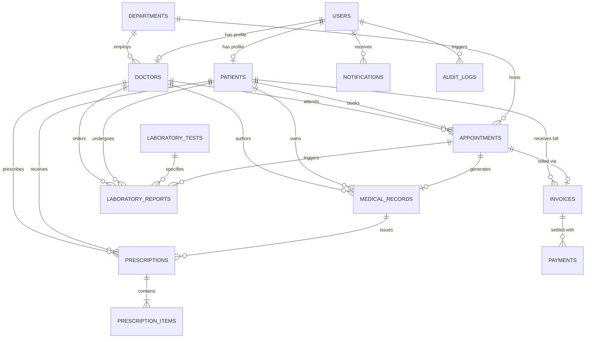

# Database Architecture & Entity Relationship Specification

## Hospital Management System (HMS) - Version 1.0

This document formally specifies the database schema, entity structures, constraints, and relationships for the Hospital Management System in compliance with Section 9 of the Software Requirements Specification (SRS).

---

## 1. Entity-Relationship Diagram (ERD)

---

## 2. Entity Dictionary & Data Constraints

### 2.1 Table: `users`
Represents system user credentials and role-based authorization attributes (**FR-AUTH-001**, **FR-AUTH-002**).

| Column Name | Data Type | Nullable | Constraints | Description |
| :--- | :--- | :--- | :--- | :--- |
| `id` | INTEGER | No | PRIMARY KEY, AUTOINCREMENT | System surrogate identifier |
| `username` | VARCHAR(80) | No | UNIQUE, INDEX | Unique login handle |
| `email` | VARCHAR(120) | No | UNIQUE, INDEX | User communication email |
| `password_hash` | VARCHAR(255) | No | PBKDF2/SHA256 Hashed | Salted cryptographic password hash |
| `role` | VARCHAR(50) | No | CHECK(role in 6 roles) | System role classification |
| `full_name` | VARCHAR(120) | No | - | User legal display name |
| `phone` | VARCHAR(30) | Yes | - | Contact telephone |
| `is_active` | BOOLEAN | No | DEFAULT TRUE | Soft deactivation flag |
| `created_at` | DATETIME | No | DEFAULT UTC_TIMESTAMP | Audit creation timestamp |

### 2.2 Table: `departments`
Represents hospital clinical divisions and medical units.

| Column Name | Data Type | Nullable | Constraints | Description |
| :--- | :--- | :--- | :--- | :--- |
| `id` | INTEGER | No | PRIMARY KEY, AUTOINCREMENT | Unique department ID |
| `code` | VARCHAR(20) | No | UNIQUE | Clinical shortcode (e.g. CARD, PEDI) |
| `name` | VARCHAR(100) | No | UNIQUE | Department title |
| `description` | TEXT | Yes | - | Clinical scope and summary |
| `created_at` | DATETIME | Yes | DEFAULT UTC_TIMESTAMP | Timestamp |

### 2.3 Table: `doctors`
Represents physician profiles, consultation settings, and clinic schedules.

| Column Name | Data Type | Nullable | Constraints | Description |
| :--- | :--- | :--- | :--- | :--- |
| `id` | INTEGER | No | PRIMARY KEY, AUTOINCREMENT | Doctor record ID |
| `user_id` | INTEGER | No | FK(users.id), UNIQUE | Linked user account |
| `department_id` | INTEGER | Yes | FK(departments.id) | Affiliated department |
| `specialization`| VARCHAR(120) | No | - | Clinical sub-specialty |
| `qualification` | VARCHAR(120) | No | - | Degrees & certifications (MBBS, MD) |
| `consultation_fee` | FLOAT | No | DEFAULT 50.0 | Standard visit rate in USD |
| `room_number` | VARCHAR(20) | Yes | - | Clinic / consultation room |
| `available_days`| VARCHAR(100) | Yes | - | Comma-separated active days |
| `start_time` | VARCHAR(10) | Yes | DEFAULT '09:00' | Clinic opening time |
| `end_time` | VARCHAR(10) | Yes | DEFAULT '17:00' | Clinic closing time |

### 2.4 Table: `patients`
Represents registered patient records (**FR-PAT-001**).

| Column Name | Data Type | Nullable | Constraints | Description |
| :--- | :--- | :--- | :--- | :--- |
| `id` | INTEGER | No | PRIMARY KEY, AUTOINCREMENT | Internal patient ID |
| `user_id` | INTEGER | Yes | FK(users.id), UNIQUE | Optional linked portal login |
| `patient_id_number` | VARCHAR(30) | No | UNIQUE, INDEX | Hospital MRN (`PAT-YYYY-XXXX`) |
| `first_name` | VARCHAR(60) | No | - | Patient given name |
| `last_name` | VARCHAR(60) | No | - | Patient family name |
| `date_of_birth` | DATE | No | - | Birth date for age calculation |
| `gender` | VARCHAR(20) | No | - | Male / Female / Other |
| `blood_group` | VARCHAR(10) | Yes | - | ABO / Rh group (e.g. O+, A-) |
| `phone` | VARCHAR(30) | No | - | Primary patient contact |
| `email` | VARCHAR(120) | Yes | - | Notification email |
| `address` | TEXT | No | - | Physical residence |
| `emergency_contact_name` | VARCHAR(120) | No | - | Next of kin / emergency contact |
| `emergency_contact_phone` | VARCHAR(30) | No | - | Emergency phone number |
| `medical_history` | TEXT | Yes | - | Allergies & chronic medical background |
| `is_active` | BOOLEAN | No | DEFAULT TRUE | Record retention flag |
| `created_at` | DATETIME | Yes | DEFAULT UTC_TIMESTAMP | Registration date |

### 2.5 Table: `appointments`
Represents scheduled and historical doctor visits (**FR-APT-001**, **FR-APT-002**).

| Column Name | Data Type | Nullable | Constraints | Description |
| :--- | :--- | :--- | :--- | :--- |
| `id` | INTEGER | No | PRIMARY KEY, AUTOINCREMENT | Unique appointment ID |
| `appointment_number` | VARCHAR(30) | No | UNIQUE, INDEX | Reference code (`APT-YYYY-XXXX`) |
| `patient_id` | INTEGER | No | FK(patients.id) | Patient reference |
| `doctor_id` | INTEGER | No | FK(doctors.id) | Doctor reference |
| `department_id` | INTEGER | Yes | FK(departments.id) | Department reference |
| `appointment_date` | DATE | No | INDEX | Scheduled calendar date |
| `time_slot` | VARCHAR(20) | No | - | Slot time (e.g. '10:00', '10:30') |
| `status` | VARCHAR(30) | No | DEFAULT 'Scheduled' | Scheduled / Completed / Cancelled |
| `reason` | VARCHAR(255) | Yes | - | Chief complaint / visit goal |
| `notes` | TEXT | Yes | - | Receptionist / triage notes |
| `created_at` | DATETIME | Yes | DEFAULT UTC_TIMESTAMP | Booking timestamp |

### 2.6 Table: `medical_records`
Clinical documentation authored by physicians during consultations.

| Column Name | Data Type | Nullable | Constraints | Description |
| :--- | :--- | :--- | :--- | :--- |
| `id` | INTEGER | No | PRIMARY KEY, AUTOINCREMENT | Record ID |
| `record_number` | VARCHAR(30) | No | UNIQUE, INDEX | Clinical reference (`REC-YYYY-XXXX`) |
| `patient_id` | INTEGER | No | FK(patients.id) | Patient reference |
| `doctor_id` | INTEGER | No | FK(doctors.id) | Attending physician |
| `appointment_id` | INTEGER | Yes | FK(appointments.id), UNIQUE | Linked consultation visit |
| `visit_date` | DATE | No | DEFAULT CURRENT_DATE | Date of clinical visit |
| `symptoms` | TEXT | No | - | Reported patient symptoms |
| `diagnosis` | TEXT | No | - | Established clinical diagnosis |
| `treatment_plan` | TEXT | Yes | - | Prescribed care regimen |
| `blood_pressure`| VARCHAR(20) | Yes | - | Vital BP (mmHg) |
| `pulse_rate` | VARCHAR(20) | Yes | - | Heart rate (bpm) |
| `temperature` | VARCHAR(20) | Yes | - | Core temp (°F/°C) |
| `weight` | VARCHAR(20) | Yes | - | Patient weight (kg) |
| `notes` | TEXT | Yes | - | Confidential clinical remarks |
| `created_at` | DATETIME | Yes | DEFAULT UTC_TIMESTAMP | Creation timestamp |

### 2.7 Table: `prescriptions` & `prescription_items`
Medication regimens and line-item pharmaceutical items.

**`prescriptions`**:
- `id`: Primary key
- `prescription_number`: Unique Rx reference (`RX-YYYY-XXXX`)
- `medical_record_id`: FK to `medical_records`
- `patient_id`: FK to `patients`
- `doctor_id`: FK to `doctors`
- `date_issued`: Issuance date
- `status`: Active / Filled / Cancelled

**`prescription_items`**:
- `id`: Primary key
- `prescription_id`: FK to `prescriptions`
- `medicine_name`: Drug name and brand
- `dosage`: e.g., '500 mg'
- `frequency`: e.g., 'Twice daily'
- `duration`: e.g., '7 days'
- `instructions`: e.g., 'Take after meals'

### 2.8 Table: `laboratory_tests` & `laboratory_reports`
Diagnostic test catalog and patient laboratory test orders.

**`laboratory_tests`**:
- `id`: Primary key
- `test_code`: Unique identifier (e.g. CBC, LIPID)
- `test_name`: Complete Blood Count
- `department`: Pathology, Biochemistry, Hematology
- `normal_range`: Standard biological reference range
- `unit`: Unit of measurement
- `cost`: Price in USD

**`laboratory_reports`**:
- `id`: Primary key
- `report_number`: Unique lab report ID (`LAB-YYYY-XXXX`)
- `patient_id`: FK to `patients`
- `doctor_id`: FK to `doctors`
- `test_id`: FK to `laboratory_tests`
- `appointment_id`: Optional FK to `appointments`
- `status`: Pending / Sample Collected / In-Progress / Completed
- `test_result`: Quantitative or qualitative observed finding
- `reference_range`: Normal biological range for comparison
- `performed_by`: Name of laboratory scientist
- `report_date`: Completion timestamp

### 2.9 Table: `invoices` & `payments`
Consolidated hospital revenue, billing records, and payment transactions.

**`invoices`**:
- `id`: Primary key
- `invoice_number`: Unique invoice ID (`INV-YYYY-XXXX`)
- `patient_id`: FK to `patients`
- `appointment_id`: FK to `appointments`
- `subtotal`: Sum of consultations + labs + pharmacy
- `discount`: Applied discount
- `tax`: Applied tax/surcharge
- `total_amount`: Final payable amount
- `paid_amount`: Sum of completed payments
- `balance_due`: Remaining outstanding balance
- `status`: Unpaid / Partially Paid / Paid / Cancelled

**`payments`**:
- `id`: Primary key
- `payment_number`: Unique receipt ID (`PAY-YYYY-XXXX`)
- `invoice_id`: FK to `invoices`
- `amount_paid`: Transaction amount in USD
- `payment_method`: Cash / Credit Card / Debit Card / Health Insurance / Online
- `transaction_reference`: External check or gateway authorization ID
- `received_by`: Staff name / cashier
- `payment_date`: Timestamp of payment

### 2.10 Table: `audit_logs`
Security compliance and forensic tracking (**SRS Section 12**).

- `id`: Primary key
- `user_id`: FK to `users` (nullable on deletion)
- `username`: Snapshot of user username
- `role`: Role at time of action
- `action`: Specific operation code (e.g., `LOGIN_FAILED`, `BOOK_APPOINTMENT`, `UPDATE_LAB_RESULTS`)
- `entity`: Target model entity (e.g., `Patient`, `Appointment`)
- `entity_id`: ID of target record
- `details`: Descriptive context
- `ip_address`: Remote client IP
- `timestamp`: Timestamp of occurrence
